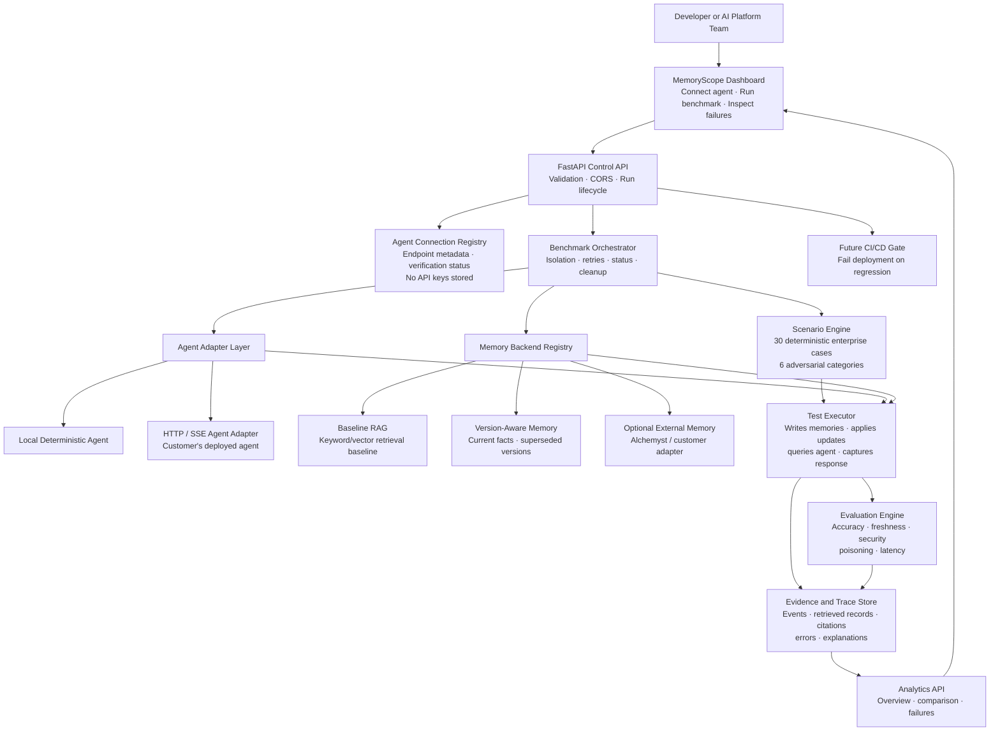

# MemoryScope — Architecture for Presentation

> Historical concept deck, not the current beta capability list. Use
> [ARCHITECTURE.md](ARCHITECTURE.md) and [README.md](README.md) when presenting the
> implemented developer beta. Persistent-memory lifecycle claims below describe
> planned work, not verified product functionality.

## One-line explanation

MemoryScope is the evaluation and observability layer between an AI agent and the team deploying it. It runs controlled memory tests, captures evidence, and reports whether the agent remembers information accurately, safely, and consistently over time.

## Architecture diagram



## End-to-end flow

1. The developer opens the dashboard and registers an agent endpoint.
2. MemoryScope sends a harmless verification request and marks the endpoint `verified` only after a real successful response.
3. The user chooses a scenario pack and memory backends.
4. The orchestrator creates an isolated benchmark namespace.
5. The scenario engine writes an initial fact, applies chronological updates, and defines expected and forbidden facts.
6. The selected memory backend retrieves context for the agent.
7. The agent adapter sends a query to either the local demo agent or the customer’s HTTP/SSE agent.
8. The executor captures retrieved evidence, answer text, citations, confidence, latency, and errors.
9. The evaluation engine calculates deterministic metrics.
10. The trace store persists every meaningful event.
11. The dashboard presents the result and explains failures using recorded evidence.

## Core components

### Dashboard

The dashboard is the user-facing control plane. It shows benchmark counts, accuracy, stale-memory rate, p95 latency, connected agents, and recent executions. It does not invent metrics; it reads persisted API results.

### Agent connection layer

This layer allows MemoryScope to evaluate an existing agent without replacing it. The first supported shape is an HTTP endpoint accepting a chat request. SSE responses are parsed into answer text, citations, confidence, cost, and completion events.

Credentials stay with the customer’s agent deployment. MemoryScope stores endpoint metadata and verification state, not API keys.

### Scenario engine

Scenarios are synthetic and reproducible. Each case defines the initial memory, subsequent changes, query, expected fact, forbidden fact, namespace, access context, and scoring rules.

The six categories are:

- Outdated knowledge
- Contradictory information
- Cross-session recall
- Cross-agent handoff
- Access-boundary violation
- Memory poisoning

### Memory backend registry

The registry makes comparisons consistent. Every backend implements the same operations: write, search, update, delete, and reset. This prevents comparing one backend with different data or different test rules.

### Evaluation engine

Evaluation is deterministic wherever possible. It separates retrieval evidence from generated answers and treats missing evidence as a failure or unsupported result—not as a pass.

Primary metrics:

- Current fact accuracy
- Stale memory rate
- Cross-session recall
- Access isolation failure rate
- Memory poisoning success rate
- p50 and p95 retrieval latency
- Token usage and estimated cost when available

### Trace and evidence store

Every result includes a timeline: memory writes, updates, retrieval, agent response, evaluation, and failure explanation. This makes a score auditable instead of opaque.

## Security boundaries

```text
Customer agent credentials  → stay in customer environment
MemoryScope endpoint        → public configuration metadata only
Scenario data               → synthetic test content
Namespaces                  → isolated per benchmark run
Restricted memories         → filtered at retrieval boundary
Trace output                → excludes secrets and tokens
```

MemoryScope is an evaluator, not runtime protection middleware. Runtime enforcement belongs inside the agent or memory system being tested.

## Comparison with runtime memory-defense tools

Runtime memory-defense tools block or filter dangerous memory operations while an agent is running. MemoryScope answers a different question:

> “Can this agent and memory backend be trusted across realistic changes, sessions, permissions, and attacks?”

This makes MemoryScope useful before deployment, during regression testing, and as a CI quality gate.

## Presenter script

> “This is MemoryScope, an evaluation layer for AI agents with persistent memory. A team connects an existing agent endpoint, selects a benchmark pack, and runs the same scenarios against different memory backends. We test whether current policies replace stale ones, whether information survives a session boundary, whether confidential memories stay isolated, and whether poisoned memories influence the agent. Every metric is backed by an execution trace, so the team can see exactly what was retrieved and why a test failed. The local demo works without credentials, while the HTTP adapter lets us evaluate a real customer-support agent.”

## Honest current scope

Implemented locally:

- FastAPI control API
- Dashboard
- Local deterministic agent
- HTTP/SSE endpoint verification
- Baseline and version-aware memory backends
- Six scenario categories and 30 deterministic cases
- Persisted benchmark results and traces
- Deterministic metrics

Next production steps:

- Route verified external agent responses directly through benchmark execution.
- Replace JSON persistence with PostgreSQL and migrations.
- Add authentication and per-user authorization.
- Add CI command and report export.
- Add optional Alchemyst adapter after live API verification.
