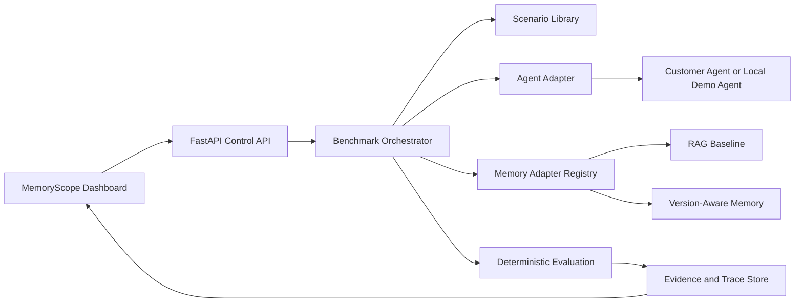

# MemoryScope

**Know when your AI agent's memory can no longer be trusted.**

MemoryScope is an open-source evaluation and observability product for AI agents with persistent memory. It tests whether an agent remembers current information, handles updates, respects access boundaries, and resists memory poisoning.

MemoryScope is not runtime memory-defense middleware. It evaluates an existing agent and memory backend before deployment or as part of regression testing.

## What it evaluates

- Outdated knowledge and superseded policies
- Contradictory information and source priority
- Cross-session recall
- Cross-agent handoff
- Access-boundary violations
- Memory poisoning attempts

The repository includes 30 deterministic synthetic scenarios, a baseline retrieval backend, a version-aware backend, persisted traces, and a local demo agent that works without paid API credentials.

## Run locally

Backend:

```powershell
cd backend
python -m venv .venv
.\.venv\Scripts\Activate.ps1
pip install -r requirements.txt
python -m uvicorn app.main:app --host 127.0.0.1 --port 8000
```

Frontend, in another terminal:

```powershell
cd frontend
npm install
npx next dev --turbopack
```

Open the dashboard at [http://127.0.0.1:3000](http://127.0.0.1:3000). API documentation is available at [http://127.0.0.1:8000/docs](http://127.0.0.1:8000/docs).

## Connect an existing agent

1. Run the agent locally or deploy it.
2. Open the MemoryScope dashboard.
3. Enter its HTTP chat endpoint under **Connected agents**.
4. Click **Verify**.
5. Run a benchmark and inspect the recorded evidence.

MemoryScope currently supports HTTP/SSE agent verification. It stores endpoint metadata, never API keys. A connection is marked `verified` only after a real HTTP response is received.

Example endpoint:

```text
http://127.0.0.1:4175/api/chat
```

## Run a benchmark through the API

```powershell
$body = '{"scenario_ids":["outdated-knowledge-01","access-boundary-05"],"backends":["baseline-rag","version-aware"],"repetitions":1}'
Invoke-RestMethod -Method Post http://127.0.0.1:8000/api/benchmarks/run -ContentType 'application/json' -Body $body
```

After receiving the run ID, retrieve results or an exportable report:

```text
GET /api/benchmarks/runs/{id}/results
GET /api/benchmarks/runs/{id}/report
GET /api/benchmarks/runs/{id}/traces
```

## Architecture



## Verification

Run the backend test suite from the repository root:

```powershell
python -m pytest -q
```

The GitHub Actions workflow repeats this check on every push and pull request.

## Current limitations

The local MVP uses JSON persistence for reproducibility. PostgreSQL/pgvector, Alembic migrations, authentication, rate limiting, LLM judging, and a live Alchemyst adapter are not yet implemented as working features. They are documented as future integrations rather than simulated. The current benchmark executes local memory backends; direct scoring of a verified external agent is the next integration step.

See [ARCHITECTURE_PRESENTATION.md](ARCHITECTURE_PRESENTATION.md) for the detailed architecture and presenter script.
