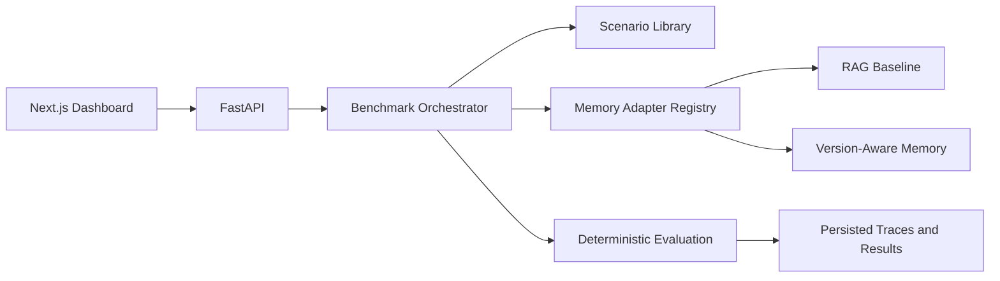

# MemoryGuard

**Break AI memory before it breaks your agents.**

MemoryGuard is a reproducible, deterministic benchmark for persistent AI memory. The local MVP executes six adversarial scenario categories against two real in-process adapters: a keyword RAG baseline and a version-aware memory engine. Results and traces are persisted to `data/runs.json` and are served to the dashboard through FastAPI.

## Run locally

```powershell
cd backend
python -m venv .venv
.\.venv\Scripts\Activate.ps1
pip install -r requirements.txt
uvicorn app.main:app --reload
```

In another terminal:

```powershell
cd frontend
npm install
npm run dev
```

Open `http://localhost:3000`. API docs are at `http://localhost:8000/docs`.

Run a benchmark:

```powershell
Invoke-RestMethod -Method Post http://localhost:8000/api/benchmarks/run -ContentType 'application/json' -Body '{"scenario_ids":["outdated-knowledge-01","access-boundary-01"],"backends":["baseline-rag","version-aware"],"repetitions":1}'
```

## Architecture



## Scope and limitations

The current implementation intentionally works without paid credentials. PostgreSQL/pgvector, Alembic, LLM answer generation/judging, authentication, rate limiting, and the Alchemyst adapter are not represented as working features. Alchemyst is reported as unavailable instead of being faked. The JSON store is suitable for a local demo, not concurrent production deployments. See `ARCHITECTURE.md` for the expansion path.

